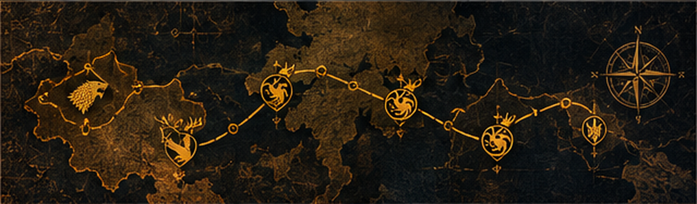

<!--
SETUP: Replace YOUR_GITHUB_USERNAME and YOUR_EMAIL.
Upload assests/ alongside this file. Project URLs are intentionally not fabricated.
Replace each project title's #repository-links target with its real repository URL.
Enable the commented snake image only after the workflow succeeds.
-->

  

<h1 align="center">Lokesh Kumar S — The Builder of Digital Kingdoms</h1>

  <strong>Forging Intelligence. Building Systems. Conquering Complexity.</strong> 
  Computer Science and Engineering student · Sri Sairam Institute of Technology, India 
  Practical AI • Backend APIs • Intelligent automation

  
  
  
  
  

  <a href="#about">About</a> ·
  <a href="#skills">Skills</a> ·
  <a href="#projects">Projects</a> ·
  <a href="#achievements">Achievements</a> ·
  <a href="#github-stats">GitHub Stats</a> ·
  <a href="#contact">Contact</a>

> **My oath:** I build intelligent systems, engineer practical solutions, and continuously expand my technical kingdom.

Prefer less motion? Open the static artwork collection

[Dragon forge](./assests/dragon-forge.png) · [Winter watch](./assests/winter-watch.png) · [Raven flight](./assests/raven-flight.png)

These links are still-image alternatives, not a page-wide animation switch.

## About
### The Chronicles of Lokesh

I’m **Lokesh Kumar S**, a **Computer Science and Engineering student at Sri Sairam Institute of Technology, India**. I enjoy turning real-world problems into practical software: from analyzing public feedback to building monitoring APIs and exploring explainable image classification.

My project experience spans **Python, backend APIs, machine learning, and automation**. I’m interested in the full journey from data and model behavior to application workflows and useful interfaces.

**Career interests:** Software Engineering · AI/ML · Backend Development · Computer Vision · NLP · Generative AI · Data Analytics · API Development · System Design.

I’m continuously strengthening my programming fundamentals and software engineering practices while exploring how intelligent systems can be made clearer, more useful, and easier to maintain.

## Skills
### The Armory of Westeros

*The houses below are creative metaphors for my skills and learning interests—not official affiliations or claims of mastery.*

#### The Weapons of the Realm

#### The Art of Machine Intelligence

#### The Foundations of the Kingdom

#### The Vaults of Knowledge

#### The Tools of the Maesters

### The Six Houses of My Craft

❄ House Stark — The Guardians of Logic

**The oath:** Make the reasoning clear before making the solution clever.

Strengthening data structures, algorithms, and problem-solving; working toward clean code and reliable application behavior.

♜ House Targaryen — The Fire of Artificial Intelligence

**The oath:** Turn data into useful intelligence—and make the reasoning inspectable.

AI, ML, deep learning, NLP, and computer vision through multilingual sentiment analysis and PyTorch image classification with Grad-CAM.

[Enter the dragon forge](#projects)

♛ House Lannister — The Architects of Systems

**The oath:** Build foundations that applications can depend on.

Backend development, Flask, REST APIs, database-backed workflows, and a growing interest in system design.

⚒ House Baratheon — The Power of Engineering

**The oath:** Translate fundamentals into working software.

Python, Java, C, programming fundamentals, and practical implementation across monitoring tools, dashboards, and desktop automation.

⚓ House Greyjoy — The Explorers of New Technologies

**The oath:** Explore beyond the familiar—and learn from the experiment.

Generative AI interests, publishing integrations, content automation, and experimental application workflows.

△ House Arryn — The Vision Beyond the Mountains

**The oath:** Keep learning beyond the next summit.

Continuous technical learning, research-minded exploration, and ambitious goals in software engineering and applied AI.

## Projects
### The Council of Inventors

Six projects at the intersection of intelligence, systems, and practical automation.

*Project titles currently open the repository-link register. Replace those targets with actual repository URLs before publishing. No deployment or performance claims are implied.*

<!-- Single-column cards keep long descriptions readable without a wide two-column grid. -->
<table>
<tr><td>
<h3>📜 <a href="#repository-links">Government Sentiment Analysis Dashboard</a></h3>

<strong>The Voice of the Realm</strong> — Analyzes public comments on draft legislation through multilingual translation, sentiment classification, and visual exploration.

<strong>Context:</strong> MCA21 public consultation analytics and SIH 2025. 
<strong>Technical value:</strong> Connects multilingual text processing with dashboard-based analysis of public feedback. 
<strong>Repository:</strong> <code>GOV_SENTIMENT_REPO_URL</code> — URL to be supplied.

</td></tr>
<tr><td>
<h3>🛡 <a href="#repository-links">Diabetic Foot Ulcer Classification</a></h3>

<strong>The Maester’s Lens</strong> — Classifies medical images using a PyTorch SimpleCNN and includes Grad-CAM explainability.

<strong>Classes:</strong> Healthy, Superficial, Deep, Infected, and Gangrene. 
<strong>Technical value:</strong> Combines five-class image prediction with visual model explanations. 
<strong>Scope:</strong> Presented as a technical project, not a clinically validated diagnostic tool. 
<strong>Repository:</strong> <code>DFU_CLASSIFICATION_REPO_URL</code> — URL to be supplied.

</td></tr>
<tr><td>
<h3>🏰 <a href="#repository-links">CPU Anomaly Detection and Monitoring</a></h3>

<strong>The Watchtower</strong> — Monitors CPU utilization and detects unusual usage patterns through Flask-based monitoring APIs and dashboards.

<strong>Technical value:</strong> Connects utilization data, statistical features, anomaly reporting, and operational monitoring. 
<strong>Repository:</strong> <code>CPU_MONITORING_REPO_URL</code> — URL to be supplied.

</td></tr>
<tr><td>
<h3>✉ <a href="#repository-links">OmniPost — Content Automation</a></h3>

<strong>The Herald’s Dispatch</strong> — Explores publishing-platform integrations, content distribution, and backlink workflow automation.

<strong>Focus:</strong> SEO, AEO, GEO, and automated publishing workflows. 
<strong>Technical value:</strong> Explores how platform integrations can coordinate repetitive publishing tasks. 
<strong>Repository:</strong> <code>OMNIPOST_REPO_URL</code> — URL to be supplied.

</td></tr>
<tr><td>
<h3>◈ <a href="#repository-links">Polar Analytics / Service Intelligence</a></h3>

<strong>The Steward’s Ledger</strong> — A service and AMC management application with database-backed, dashboard-oriented workflows.

<strong>Technical value:</strong> Organizes service workflows around operational visibility and service intelligence. 
<strong>Repository:</strong> <code>POLAR_ANALYTICS_REPO_URL</code> — URL to be supplied.

</td></tr>
<tr><td>
<h3>⚙ <a href="#repository-links">Jarvis-Style Desktop AI Assistant</a></h3>

<strong>The Maester’s Familiar</strong> — A Python voice assistant with speech recognition, speech output, desktop automation, and application launching.

<strong>Technical value:</strong> Connects voice interaction with practical desktop actions. 
<strong>Repository:</strong> <code>DESKTOP_ASSISTANT_REPO_URL</code> — URL to be supplied.

</td></tr>
</table>

#### Repository Links

Open the repository-link register

Actual repository URLs have not yet been supplied. These are explicit placeholders, not live links:

- Government Sentiment Analysis: `GOV_SENTIMENT_REPO_URL`
- Diabetic Foot Ulcer Classification: `DFU_CLASSIFICATION_REPO_URL`
- CPU Anomaly Detection: `CPU_MONITORING_REPO_URL`
- OmniPost: `OMNIPOST_REPO_URL`
- Polar Analytics: `POLAR_ANALYTICS_REPO_URL`
- Desktop AI Assistant: `DESKTOP_ASSISTANT_REPO_URL`

## Achievements
### The Hall of Honor

| Seal | Recognition or activity | Record |
| :---: | :--- | :--- |
| 🛡 | **Smart India Hackathon 2025** | Pre-Finalist |
| ✦ | **NPTEL Discipline Star 2026** | Discipline Star recognition |
| ✦ | **NPTEL Star** | Three-time recognition, as reported in my profile details |
| ⚔ | **SkillRack** | More than **32,000 points** |
| ◈ | **IoT coursework** | **84%** |
| ⚙ | **IEEE SPAX Innovatex 2025 at RIT** | Participation |
| ⚑ | **Fit India initiative** | Activity involvement |
| ⚑ | **Scouts for SDGs** | Activity involvement |

*The NPTEL entries are presented as supplied; no additional award count is inferred. Participation and activity involvement are not presented as wins or certifications.*

**Ongoing quests:** Technical coursework, project-based learning, programming practice, and exploration across AI, APIs, analytics, and automation.

## GitHub Stats
### The Chronicles

**Code leaves a record. These are the chronicles of the work.**

<!-- Replace YOUR_GITHUB_USERNAME before enabling or relying on these widgets. -->

Open the live chronicles — statistics, streak, languages, and activity

These are **third-party visualizations of GitHub data**, not official GitHub dashboards. They may be cached, rate-limited, or temporarily unavailable.

Language statistics describe repository composition, not proficiency or total coding time.

**Always-available navigation:** [GitHub profile and contribution calendar](https://github.com/YOUR_GITHUB_USERNAME) · [Repositories](https://github.com/YOUR_GITHUB_USERNAME?tab=repositories)

If a widget fails, use those native GitHub pages or remove its image block.

The Contribution Serpent — optional animation

The serpent is configured through `.github/workflows/snake.yml`. Enable the image below only after the workflow successfully publishes `github-contribution-grid-snake.svg` to the `output` branch.

<!--

-->

Until then: [View my contribution calendar](https://github.com/YOUR_GITHUB_USERNAME).

## Contact
### The Raven Network

Interested in **AI, ML, backend development, or open-source collaboration**? Send a raven—let’s discuss something useful to build.

  
  
  

**Email:** `YOUR_EMAIL` — address to be supplied.
<!-- After supplying your email, replace the line above with:

-->

[LinkedIn](https://linkedin.com/in/lokesh-kumar-03504b294) · [Portfolio](https://portfolio-one-pink-48.vercel.app/) · [GitHub](https://github.com/YOUR_GITHUB_USERNAME)

---

  <strong>“Build with purpose. Learn without end. Let the work speak.”</strong> 
  An original fantasy-inspired developer identity. House names are creative references, not affiliations or endorsements.  
  <a href="#about">Return to the chronicles ↑</a>

<!-- Artwork is repository-hosted. Badges and live statistics depend on external services.
No visitor counter is enabled: this profile does not claim a verified unique-visitor count.
-->
